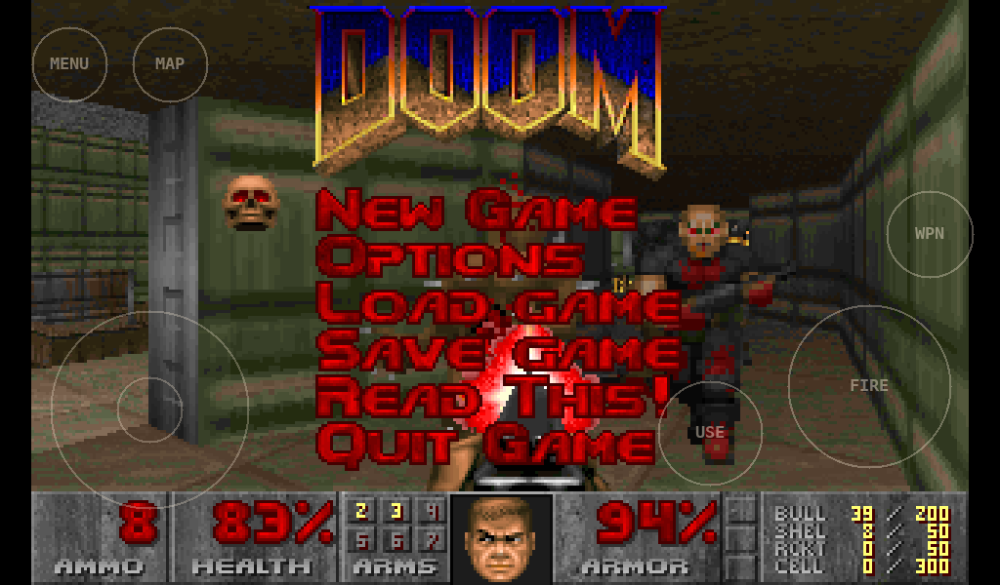

# Doom on the SparkFun IoT RedBoard - ESP32-P4



The original 1993 Doom (shareware episode 1, *Knee-Deep in the Dead*) running on the **SparkFun IoT RedBoard - ESP32-P4** with a Waveshare MIPI-DSI touchscreen:

- **Full-screen video:** Doom's 320×200 picture is scaled 3× to 960×600 on the 7" panel, or 2× to 640×400 on the 4.3".
- **Multi-touch controls:** walk and shoot at the same time. A **SparkFun Qwiic Joystick** also works.

The engine is [doomgeneric](https://github.com/ozkl/doomgeneric), a portable fork of [Chocolate Doom](https://github.com/chocolate-doom/chocolate-doom). This repository adds the ESP32-P4 platform layer: display, touch, joystick and flash storage.

> [!NOTE]
> This project was vibe coded: it was written mostly by an AI coding assistant. It will likely not be maintained, so issues and pull requests may not get a response.

## What you need

| Part | Notes |
|---|---|
| SparkFun IoT RedBoard - ESP32-P4 | |
| Waveshare **7-DSI-TOUCH-C** (1024×600) or **4.3-DSI-TOUCH-A** (480×800) | Auto-detected at start-up |
| 22-pin to 15-pin "Raspberry Pi 5 display cable" | The 22-pin, 0.5 mm end fits the RedBoard |
| 2 jumper wires | Panel 5 V and GND |
| USB-C cable | For power, flashing and the serial log |
| *Optional:* [SparkFun Qwiic Joystick](https://www.sparkfun.com/products/15168) (COM-15168) + Qwiic cable | |

## Hookup

### Display

1. **Cable:** plug the 22-pin end into **J6**, the DSI connector (J5 next to it is the camera port, and won't work). Plug the 15-pin end into the panel. J6 is a lower-contact connector. If the panel stays white or dark, check the cable is the right way round. A reversed cable won't damage anything.
2. **Power:** J6 only carries 3.3 V, so the panel needs its 5 V from a separate wire:

   | Panel | RedBoard |
   |---|---|
   | 5V | **J8 pin 4 (`5V`)** |
   | GND | **J8 pin 2 or 3 (`GND`)** |

   The RedBoard's 5 V rail comes from USB-C or the barrel jack. It isn't there when the board runs from a LiPo alone, so the panel won't light up on battery power. The backlight draws a few hundred mA, so use a USB port or supply with some current to spare.
3. **Touch and panel control** run over I²C on **IO26/IO27**, through the same J6 cable. There's nothing else to wire.

### Qwiic Joystick (optional)

Plug it into the RedBoard's Qwiic connector. It shares the IO26/IO27 I²C bus with the panel (0x45) and its touch controller (0x5D or 0x14). The joystick (0x20) is found at start-up. Avoid other Qwiic boards at 0x14, 0x45 or 0x5D.

## Flash the prebuilt image (no build needed)

`bin/doom_full.bin` contains everything: bootloader, partition table, Doom, and the game data. Write it to offset **0x0**.

Connect the RedBoard with the USB-C port labelled for programming (**J2**, the ESP32-P4's USB-Serial/JTAG).

**With esptool** (`pip install esptool`):

```bash
esptool --chip esp32p4 write-flash 0x0 bin/doom_full.bin
```

- Add `-p <port>` if more than one serial device is connected (`/dev/ttyACM0`, `COM5` and so on).
- esptool versions older than v5 spell the command `write_flash`.

**From a browser:** open the [esptool-js web flasher](https://espressif.github.io/esptool-js/) in Chrome or Edge. Click **Connect**, set the flash address to `0x0`, choose `doom_full.bin` and click **Program**.

If the board isn't detected, put it in download mode by hand: hold **BOOT**, tap **RESET**, then let go of BOOT. After flashing, press **RESET** to start Doom.

## Controls

**Touch** (multi-touch, so you can move and shoot at once):

| Control | Where | Does |
|---|---|---|
| Stick | left thumb | up/down = walk, left/right = turn (always-run is on) |
| FIRE | right, big | Shoot. Hold to keep firing. Also ENTER in menus |
| USE | right, lower | Open doors and press switches. Also "yes" in prompts |
| WPN | right edge | Next weapon (1 → 7) |
| MAP | top left | Automap |
| MENU | top left | Doom's menu |

**Qwiic Joystick:** the stick walks and turns, and clicking it fires. Touch still works alongside it.

Doom has no reload button. Ammo feeds automatically, and holding FIRE keeps shooting. Choosing **Quit Game** from Doom's menu restarts it.

## Build from source

You need [ESP-IDF](https://docs.espressif.com/projects/esp-idf/en/latest/esp32p4/get-started/) **v6.0 or newer**. The prebuilt image was built with v6.1. The display and touch drivers are downloaded from the ESP Component Registry on the first build.

```bash
git clone --recursive https://github.com/sparkfun/SparkFun_RedBoardIoT-ESP32-P4_Examples.git
cd SparkFun_RedBoardIoT-ESP32-P4_Examples/doom
# already cloned without --recursive? run: git submodule update --init

idf.py set-target esp32p4
idf.py build
idf.py -p <port> flash monitor
```

`idf.py flash` writes the app and the game data (`wad/DOOM1.WAD`, packed into a FAT image). To rebuild `bin/doom_full.bin` from your build:

```bash
cd build
python -m esptool --chip esp32p4 merge-bin -o ../bin/doom_full.bin @flash_args
```

### Configuration

Run `idf.py menuconfig` to change these:

| Menu | Options |
|---|---|
| **Doom** | Flip the picture 180°. Invert the Qwiic Joystick axes. Joystick button polarity |
| **Waveshare DSI panel** | Force the 4.3" or 7" panel instead of auto-detecting. I²C pins. MIPI LDO channel |

## Troubleshooting

Open the serial log with `idf.py -p <port> monitor`, or any serial terminal on J2 at 115200 baud.

| Symptom | Check |
|---|---|
| Panel stays dark or white | 5 V and GND wires to J8; DSI cable orientation; is the board on USB/barrel power (not LiPo only)? |
| Picture upside down | *Doom → Flip the picture 180°* |
| Wrong panel detected | Force it under *Waveshare DSI panel* |
| `can't mount the WAD partition` | Only the app was flashed. Flash `bin/doom_full.bin` at 0x0, or use `idf.py flash` |
| `no Qwiic Joystick at 0x20` | Cable, or the joystick's address was changed |
| Joystick direction backwards, or click doesn't fire | *Doom → Qwiic Joystick* options |

## Limitations

- **No sound or music.**
- **No save games or saved settings.** The game data partition is read-only.
- **Shareware episode only.** The code loads `/wad/DOOM1.WAD`.

## How it works

| Part | Where |
|---|---|
| Platform layer: video scaling and rotation, WAD mount, exit | `main/dg_esp.c` |
| Touch overlay + Qwiic Joystick | `main/controls.c` |
| Panel detection and DSI setup | `components/ws_dsi_panel/` |
| Doom engine | `external/doomgeneric/` (git submodule) |

Flash layout (`partitions.csv`, 16 MB flash):

| Partition | Offset | Size | Contents |
|---|---|---|---|
| factory (app) | 0x10000 | 2 MB | Doom (~700 KB) |
| wad (FAT, read-only) | 0x210000 | 5 MB | DOOM1.WAD (4.2 MB) |

## License

SparkFun's own code in this repository is released under the **MIT License** (see [LICENSE](LICENSE)), except where a file's header says otherwise. Copyright (c) 2026 SparkFun Electronics.

Doom itself is GPL, so the firmware built from this repository, including `bin/doom_full.bin`, is a combined work distributed under the **GNU General Public License, version 2** ([full text](external/doomgeneric/LICENSE)). The source for it is this repository plus the doomgeneric submodule.

| Component | License |
|---|---|
| SparkFun code: `main/`, `tools/` | MIT ([LICENSE](LICENSE)) |
| [doomgeneric](https://github.com/ozkl/doomgeneric) (submodule), based on id Software's Doom source and Chocolate Doom | GPL-2.0 (see its LICENSE) |
| `components/ws_dsi_panel`: panel init sequences from Waveshare's [esp32_p4_platform](https://components.espressif.com/components/waveshare/esp32_p4_platform) BSP | Apache-2.0 ([LICENSE](components/ws_dsi_panel/LICENSE)) |
| Espressif display and touch drivers (downloaded at build time) | Apache-2.0 |
| [ESP-IDF](https://github.com/espressif/esp-idf) | Apache-2.0 |
| Control-label glyphs in `main/font_data.c`, rendered from DejaVu Sans Mono | Bitstream Vera license ([FONT_LICENSE.txt](main/FONT_LICENSE.txt)) |

### Game data

`wad/DOOM1.WAD` (and the copy inside `bin/doom_full.bin`) is the **shareware** release of Doom, version 1.9 (md5 `f0cefca49926d00903cf57551d901abe`). It is © id Software (now part of ZeniMax Media) and is **not** covered by the GPL. id released the shareware episode to be shared freely, and it's included here on that basis: unmodified and free of charge.

---

DOOM is a registered trademark of ZeniMax Media Inc. This project is not affiliated with or endorsed by id Software, ZeniMax Media or Bethesda.
